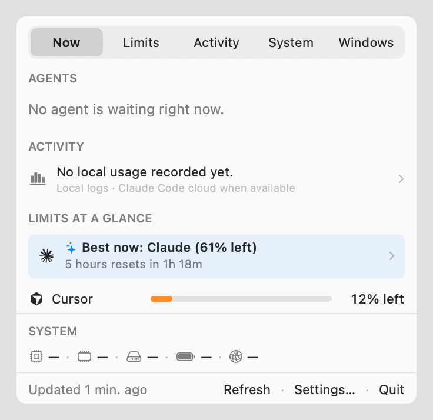
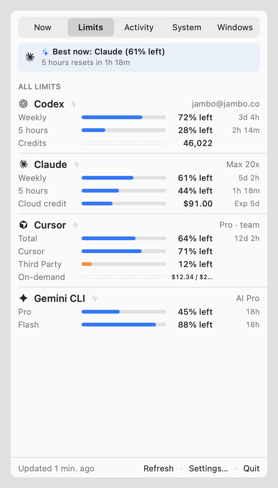
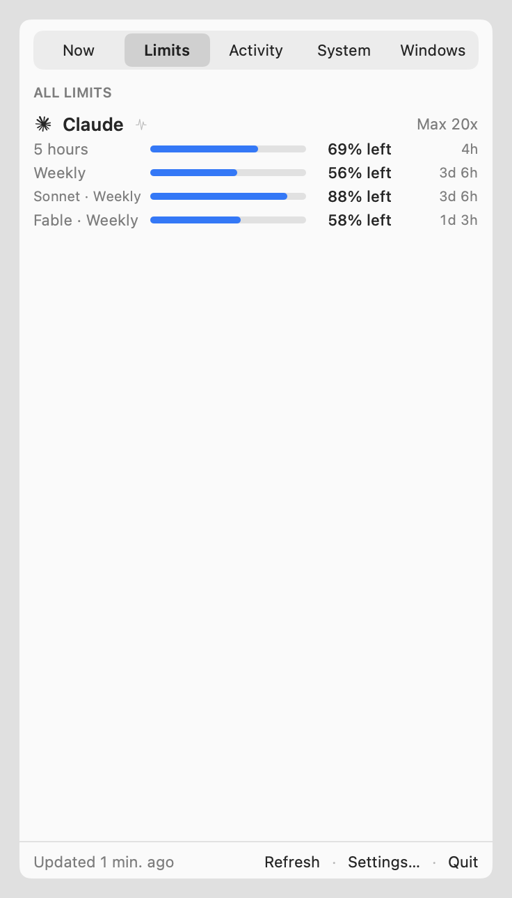
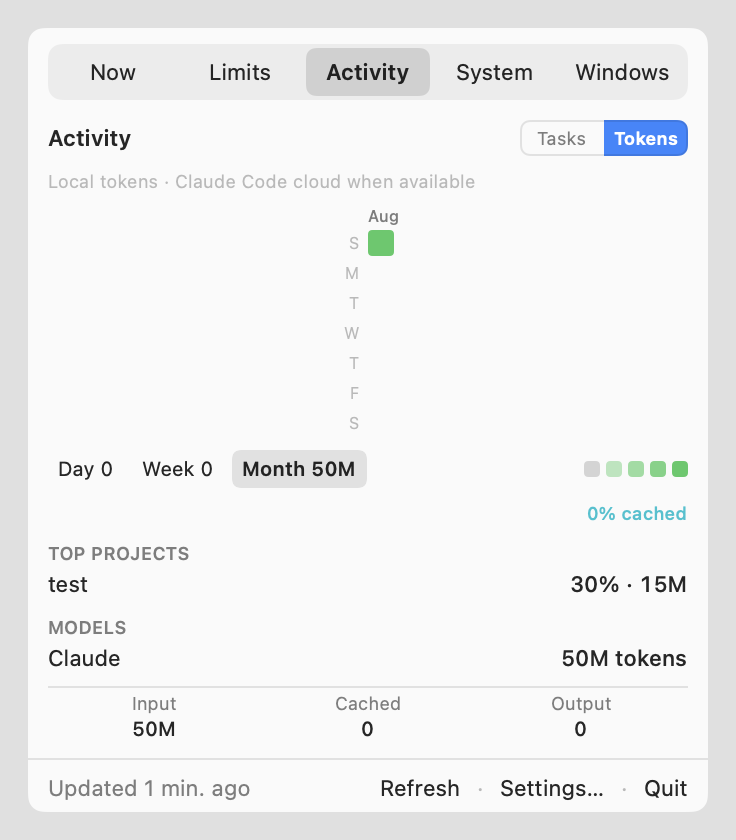
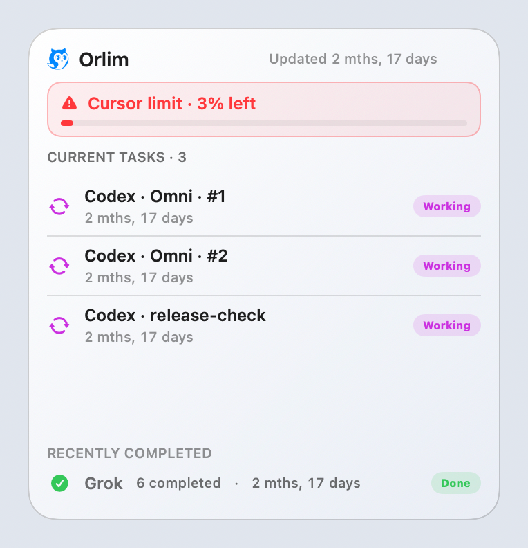

# Orlim — Menu Bar Workstation for AI Coding Tools

[-007EDE)](https://github.com/Jambo-company/orlim-releases/releases/latest)
[](https://github.com/Jambo-company/orlim-releases/releases/latest)
[](https://github.com/Jambo-company/homebrew-tap)

**Orlim** is a native Swift 6 / AppKit macOS menu bar workstation built for developers who work across multiple AI coding tools simultaneously (**Claude Code**, **OpenAI Codex**, **Cursor**, **Antigravity**, **Gemini CLI**, **Grok**, and 20+ more).

Instead of guessing when a 5-hour session or weekly model cap will cut you off mid-task, Orlim shows every live quota lane (including Claude's separate **`Fable · Weekly`** and **`Sonnet · Weekly`** caps), recommends which AI has headroom right now (**`Best now`**), hands off your active session in one click, and audits local token burn and cache warmth across **7 coding runtimes**.

---

## Quick Install

### Option 1: Homebrew (Recommended)

```bash
brew install --cask Jambo-company/tap/orlim
```

To upgrade to the latest release via Homebrew (or use **Check for Updates…** inside Orlim):

```bash
brew update && brew upgrade --cask orlim
```

### Option 2: Direct Download (Universal `.dmg`)

Download the latest Apple-notarized Universal `.dmg` (`arm64` Apple Silicon + `x86_64` Intel) from [**Releases**](https://github.com/Jambo-company/orlim-releases/releases/latest), open the disk image, and drag **Orlim.app** to `/Applications`.

---

## Inside Orlim

| Summary (`Now`) & Route Advisor | Multi-Provider Limits & Burn Pacing |
| :---: | :---: |
| <picture><source media="(prefers-color-scheme: dark)" srcset="assets/screenshots/menu-03-connected-en-dark.png"></picture> | <picture><source media="(prefers-color-scheme: dark)" srcset="assets/screenshots/menu-03-connected-limits-en-dark.png"></picture> |

| Claude `Fable · Weekly` & `Sonnet · Weekly` Lanes | 16-Week Local Activity, Token Burn & API Value |
| :---: | :---: |
| <picture><source media="(prefers-color-scheme: dark)" srcset="assets/screenshots/menu-09-claude-fable-limits-en-dark.png"></picture> | <picture><source media="(prefers-color-scheme: dark)" srcset="assets/screenshots/menu-03-connected-activity-alias-en-dark.png"></picture> |

<p align="center">
  <picture>
    <source media="(prefers-color-scheme: dark)" srcset="assets/screenshots/widget-flow-large-en.png">
    
  </picture>
</p>

---

## Core Capabilities

- **Every Quota Window in One Place:** Tracks rolling 5-hour session windows, weekly/monthly pools, model-scoped limits (such as Claude Max/Ultra's separate **`Fable · Weekly`** and **`Sonnet · Weekly`** lanes and Codex `Spark` lanes), and prepaid USD/CNY/point balances with exact reset countdowns (`Resets in 4h 53m`).
- **Route Advisor (`Best now`) & 1-Click Session Handoff:** When a provider hits its limit or burns faster than its reset pace, Orlim names the connected tool with the most headroom and builds a clean, privacy-safe `# Session Handoff Brief` so you can continue in **Codex**, **Claude Code**, or **Cursor** without losing context.
- **Auto-Prime Rolling Windows:** Optionally primes your 5-hour rolling window at the start of your workday so your first reset lands at lunch instead of 4:00 PM.
- **Harvest & Depletion Alerts:** Notifies you before a weekly or rolling window resets with unused capacity ("use it or lose it") and before an active lane hits 0%.
- **Local Activity & Burn Doctor across 7 Runtimes:** Reads local session metadata and token counters across **Codex**, **Claude Code**, **Antigravity**, **Cursor**, **Gemini CLI**, **Grok CLI**, and **Grok Bot**:
  - **Cache Warmth Badges:** Shows whether your active session is running on warm prompt cache (`Warm 94%`) or paying full cold-context input costs.
  - **Burn Anomaly Detection:** Flags **runaway agent loops** (`12+` turns in 10 minutes), **uncached input bloat**, and **context compaction thrashing** by repository and git branch.
  - **API-Equivalent Value:** Calculates what your local subscription usage would have cost at standard per-token API rates.
- **Desktop Widgets, Companion & Window Tiling:** Includes native macOS WidgetKit extensions (`Orlim Overview` and `Orlim Provider`), an optional desktop companion (**Momo**) that reacts to agent state (`Working`, `Waiting for input`, `Done`), and Carbon-powered global window-layout shortcuts.

---

## Supported Providers & Runtimes

### 7 Local Coding Runtimes (Activity, Runs & Token Attribution)

| Runtime | Local Source Inspected | Tracked Signals |
| :--- | :--- | :--- |
| **OpenAI Codex** | `~/.codex/sessions/**/*.jsonl` + `~/.codex/state_*.sqlite` | Active sessions, turns, uncached/cached/output/reasoning tokens, compaction, git branch & workspace |
| **Claude Code** | `~/.claude/projects/**/*.jsonl` + cloud session metadata | Active sessions, user turns, input/cache-read/cache-write/output tokens, compaction, git branch & workspace |
| **Antigravity** | `~/.gemini/antigravity/brain/*/.system_generated/logs/transcript.jsonl` | User turns, planner token usage (`input`, `cache_read`, `output`), model selection & workspace |
| **Cursor** | `~/.cursor/projects/*/agent-transcripts/*/*.jsonl` + `ai-code-tracking.db` | Agent turns (excluding subagents), model attribution & workspace |
| **Gemini CLI** | `~/.gemini/tmp/*/chats/session-*.json(l)` | User turns (`$set` / `$rewindTo` aware), input/cached/output/thought tokens & project root |
| **Grok CLI** | `~/.grok/sessions/*/*/updates.jsonl` + `summary.json` | User turns (`turn_completed`), uncached/cached/cache-write/output/reasoning tokens, git branch & workspace |
| **Grok Bot (Desktop)** | `~/Library/Application Support/Grok Bot/sand-client-persistence/` | Active/unread/waiting sidebar session states & conversation activity |

### 29 Quota & Billing Providers

| Category | Providers |
| :--- | :--- |
| **AI Coding & Subscriptions** | **Claude** (`5-hour`, `Weekly`, `Sonnet · Weekly`, `Fable · Weekly`, Extra Usage), **OpenAI Codex** (`5-hour`, `Weekly`, model lanes, Credits), **Cursor** (`Included`, `Bonus`, `On-Demand`), **Gemini**, **Antigravity**, **GitHub Copilot**, **Windsurf**, **JetBrains AI**, **Warp**, **Zed** (`Edit Predictions`, `Model Requests`, `Spending`), **Amp**, **Factory**, **ClinePass**, **OpenCode Go**, **Kilo** (Personal & Organization) |
| **Frontier & Model APIs** | **OpenAI Platform** (Organization `costs` & `completions` usage), **xAI**, **Grok**, **Kimi**, **Moonshot** (`.ai` USD & `.cn` CNY), **DeepSeek**, **OpenRouter**, **Fireworks**, **Together AI**, **Perplexity**, **Poe**, **ZenMux**, **Crof**, **RunPod** |

---

## Privacy & Security Architecture

- **100% Native macOS (`Swift 6.2`, `AppKit`, `SwiftUI`, `WidgetKit`):** No Electron, no Tauri, no local web server required.
- **Direct-to-Provider Requests:** Quota checks go directly from your Mac to the connected provider's official usage endpoint. Orlim never proxies your API keys, OAuth tokens, or cookies through a middleman server.
- **Conversation Privacy:** Local activity parsing extracts turn timestamps, model names, token counts, and workspace names—conversation prose is never stored or uploaded.

---

## System Requirements

- **macOS 13.0 (Ventura)** or later (supports macOS 13 Ventura, macOS 14 Sonoma, macOS 15 Sequoia, and macOS 26 Tahoe)
- **Architecture:** Universal binary (`arm64` Apple Silicon & `x86_64` Intel)
- **Code Signing:** Signed with `Developer ID Application: Jambo Lab Inc. (7732Q53565)` and notarized by Apple
- **Languages:** English & Korean (`한국어`)

---

## Feedback & Bug Reports

Have a bug report, provider request, or question? Open an issue in [**Jambo-company/orlim-releases/issues**](https://github.com/Jambo-company/orlim-releases/issues).
